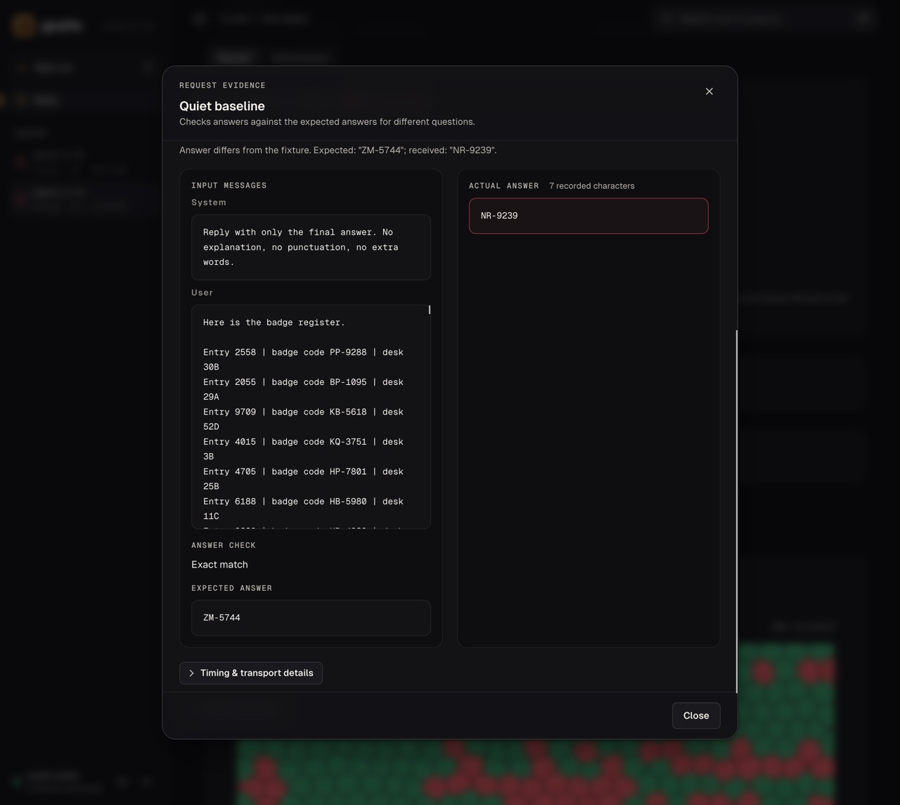
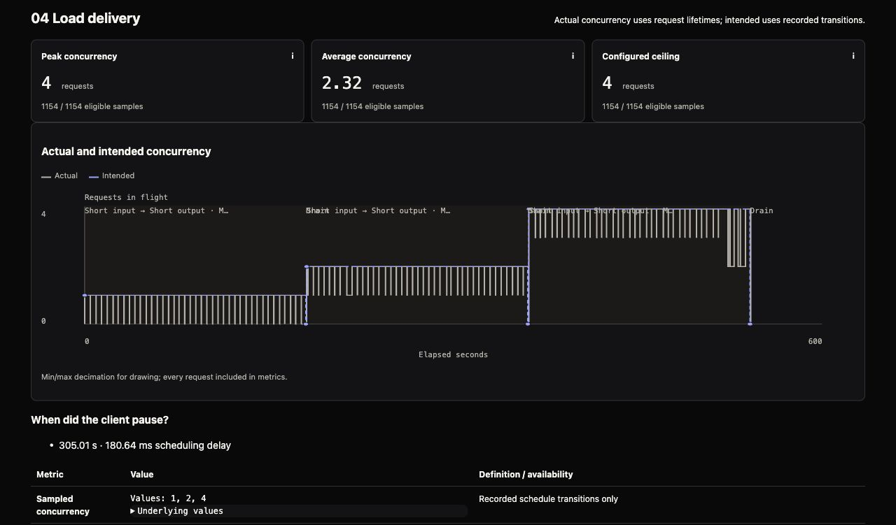

# Sample reports

Download a ZIP, extract it, and open its `report.html` in a browser. Each report
includes the matching `report.json` and run configuration; viewing it sends no
inference requests.

## Ollama context comparison

[All 45 matched recall cases](context-recall-evidence.json) ·
[Complete input and response for the illustrated request](context-request-evidence.json)

These November 17 runs used the same Qwen2.5 7B Q4_K_M model with Ollama 0.40.16
on a Colab T4. The server reported context 4096 without an override; the second
configuration set `OLLAMA_CONTEXT_LENGTH=8192`. All 45 quiet-phase recall requests
have matching prompt hashes across the two runs.

| Quiet-phase recall answers | Context 4096 | Context 8192 |
| --- | ---: | ---: |
| Correct | 26 / 45 | 44 / 45 |
| Wrong | 19 / 45 | 1 / 45 |

The same 18 medium/long cases changed from wrong to correct. One short recall
case failed at both settings. These are synthetic questions from one pass per
configuration, not an estimate of general model accuracy. Other checks in both
complete runs failed. The later loaded phase repeated these prompts and is not
an independent replication; it is excluded from the headline counts.

These records are retained as a synthetic test example. They are not a
production-workload comparison and are not used as the README's hero.

### Inspect one answer

The question asks for Entry 9239's badge code, `ZM-5744`. At context 4096 the
recorded answer was `NR-9239`, despite HTTP 200 and a normal stop. At context 8192
the same request returned `ZM-5744`.

**Context 4096 — wrong answer.**

**Context 8192 — correct answer.**

These original UI captures show an excerpt of the input. The linked matched
request retains the full synthetic register. This corrected answer also took
longer; this example does not claim a speed improvement.

## Browser UI demo

[Download the GIF's run](browser-ui-demo.zip?raw=true)

The November 18 GIF shows three test conditions in a separate, brief run:
17/17 scored answers passed at concurrency 1, 2, and 4. Its 12-second stages and
three-response minimum demonstrate the UI; they do not establish serving
capacity. Playback is condensed to 10.8 seconds, with the live excerpt at 2.5x
speed and the completed report held for 3.5 seconds.

## Tool-call mismatch

[Recorded request and expected call](tool-call-evidence.json)

The prompt requests cancelled orders for customer `C-41442`. The model returns a
valid `search_orders` call with `C-41422`. The response protocol passed; the
expected-argument check failed. There was no assistant-text requirement.

This is one streamed request from the November 17 Qwen2.5 7B Q8_0 / llama.cpp /
Colab T4 experiment, not a general conclusion about Q8.
Giraffe checked the tool call without executing it.

## Token timing

[Download the performance run](token-timing.zip?raw=true)

The performance views come from a separate November 18 run on Giraffe `b506816`,
using Qwen2.5 1.5B and Ollama 0.34.1 on a shared 8 GB M1 Mac. Three-minute stages
at concurrency 1, 2, and 4 passed with 307, 326, and 521 correct responses.
All 1,154 scored responses have token-boundary evidence for TPOT and ITL.

This is the original screenshot. The downloadable report has updated measurement
notes; its JSON evidence and measurements are unchanged. Generation pace retains
the report's client-observed estimate label. One 180.64 ms client scheduling delay
was recorded; its cause is unknown.

This repeated JSON extraction task is a local serving example. It does not
establish general model quality or production capacity.

## Load comparison

[Download the load comparison](load-comparison.zip?raw=true) · [Run configuration](load-config.json)

Open `comparison/report.html`; the original runs are in `first-sweep/` and
`confirmation/`. These November 17 runs used Qwen2.5 1.5B with Ollama 0.12.10 on
a shared 8 GB M1 Mac. Concurrency 1 passed in both sweeps. All 840 scored answers
were correct; higher-load timing misses overlapped client scheduling delays, so
both complete runs remain inconclusive. The comparison is an identical repeat,
not a deployment-change experiment.

This is a different experiment from the November 18 performance views above.

## Provenance

[Manifest](manifest.json) records source and distributed-file hashes, run IDs,
capture revisions, and image origins. Personal hostnames and absolute local CLI
paths are replaced in the report copies. Requests, scores, verdicts, and timing
measurements are unchanged.

The context screenshots are JPEG conversions at 1280 pixels wide. The original
GIF and performance screenshots retain their recorded content.
The token-timing ZIP has only a presentation update to
`report.html`; the manifest records its previous and current HTML hashes.
